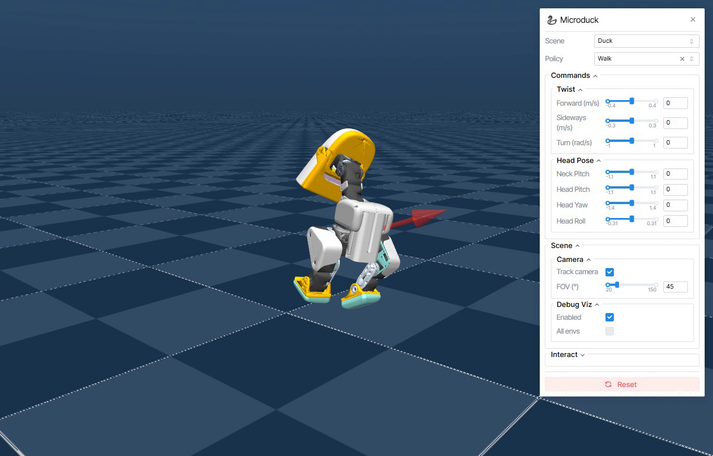

# Task 2 学习笔记：mjswan + MicroDuck 浏览器物理扰动

> 日期：2026-10-16 ｜ 实验环境：Windows 11，Python 3.12，mjswan 0.11.9
> 实验产物（2026-10-17 已迁移到 tasks/task2）：`tasks/task2/dist/microduck`（静态网页）、`tasks/task2/recordings/mjswan_microduck_manual_drag_demo.webm / .mp4`（拖拽录制）

---

## 1. 这个实验是干什么的（一句话）

把 MicroDuck 机器人和它的 ONNX 策略搬进**浏览器**里跑：MuJoCo WASM 在网页内做动力学计算，ONNX Runtime Web 做策略推理，Three.js 渲染；然后用**鼠标拖拽**给鸭子施加真实的物理外力（写入 `mjData.xfrc_applied`），观察它被"甩倒"。

验证的是一条链路：**策略回放 + 浏览器物理交互 + 静态部署**。不是重新训练策略。

## 2. 我原来以为的 vs 实际上的（认知修正）

| 我原来的想法 | 实际发现 |
|---|---|
| 网页里只是个预录好的动画 | 网页加载的是 WASM 物理引擎 + ONNX 策略，每一帧都是实时算的；断网后物理依然继续（资源已下载到本地） |
| 拖拽是策略"学会"了被拽 | 拖拽是**引擎级扰动**：指针位移换算成力和力矩，直接写进 MuJoCo 外力数组，和神经网络的 14 维动作是两条独立的注入路径 |
| 鸭子倒了应该就躺平了 | 实际录制中鸭子在摔倒后**自己爬起来了**（Walk 策略仍在跑）。但这不等于"恢复能力是学出来的"——要证明恢复能力需要在训练环境加外力扰动和恢复奖励 |
| 静态服务用 `python -m http.server` 就行 | 不行。Windows 下 `.js` 会被返回成 `text/plain`，浏览器拒绝加载模块脚本（黑屏）；另外多线程 WASM 需要 COOP/COEP 响应头。必须用任务资料里的 `serve_mjswan.py` |
| 构建产物拷给别人就能跑 | 还缺一个文件：`ort-wasm-simd-threaded.wasm`（ONNX Runtime Web 的 wasm，vite 打包时警告过 "doesn't exist at build time" 但没报错退出），需要手动补进 `dist/assets/`，否则页面报 "no available backend found" |

## 3. 运行链路（我理解的流程）

```
构建阶段（Python 端）                          浏览器运行阶段
─────────────────────                         ──────────────────────────
MicroDuck MJCF 场景 + ONNX 策略                  读 manifest.json
        │                                      选场景 / 策略
        ▼                                      │
mjswan_playground Builder ──► dist/ 静态目录      ▼
（manifest.json + 场景资源 + policy.onnx +      每个控制周期：
  WASM 运行时 + 前端 bundle）                    读 MuJoCo 状态 → 整理 61 维观测
                                                → ONNX Runtime Web 推理
                                                → 14 维动作写入 actuator
                                                → 接触/重力/摩擦/外力计算
                                                → Three.js 渲染下一帧
```

**61 维观测 → 14 维动作**：这个契约和 Task 1 篮球平衡任务完全同源（陀螺仪 3 + 重力投影 3 + 关节位置 14 + 关节速度 14 + 上一步动作 14 + 速度指令 3 + 填充 10 = 61）。这也是为什么 Task 1 训出来的策略理论上可以走同一条导出链路进浏览器。

**拖拽的注入点**（读了前端源码 `core/interaction/`）：
- 默认交互模式是 **pull（弹簧拖拽）**：`pointerdown` 射线命中刚体 → 记录命中点在体坐标系下的位置 → 拖拽中把"指针位置"当弹簧目标点，力写入 `mjData.xfrc_applied` 对应刚体行，同时显示红色力箭头；松手后外力清零。
- 还有 **push（点按冲击）** 模式：轻点（位移 < 8px）沿命中面法向给一个单步冲量。
- 8px 是"点按"和"拖拽"的分界线（`TAP_SLOP_PX`）。

## 4. 实验记录（证据）

### Checkpoint 1：场景加载 ✅
- 浏览器打开 `http://127.0.0.1:8092/`，canvas 出现，控制面板（Scene/Policy/Commands/Camera/Debug Viz/Reset）齐全
- 资源冒烟测试：index.html 200、manifest.json 200、`mujoco wasm` 200（`application/wasm`）、`policy.onnx` 200

### Checkpoint 2：策略回放 ✅
- Duck + Walk 策略，Forward 从 0 调到 0.4 m/s
- 截图对比：鸭子从直立待机变为**明显前倾 + 大步行走**（Track camera 开启时相机跟随，鸭子居中，但步态变化清晰可见）

### Checkpoint 3：物理拖拽 ✅
- 用任务自带的 `record_mjswan_drag_demo.py`（Playwright 无头 Chromium）自动执行三次拖拽：右上提拉 / 左侧推拽 / 斜向摆动
- 录制结果（39MB WebM）逐帧确认：
  - 拖拽中**红色力箭头**出现且随拖拽方向变化
  - 鸭子身体被拽得大幅倾斜、踉跄、翻倒
  - 松手后外力消失，鸭子按当时的速度和接触继续运动（不是播片）
  - 每次拖拽之间 Reset 恢复初始状态
  - **意外观察**：摔倒后 Walk 策略的鸭子能自己爬起来（但按 README 的边界声明，这不证明恢复能力是学到的）

拖拽中的红色力箭头（新环境录制，第 45 秒，左侧推拽）：



## 5. 踩坑记录（今晚真实的坑）

1. **git 全局代理失效**：配置里写的是 127.0.0.1:6696（已停用），实际代理在 7897 端口。`git config --global http.proxy http://127.0.0.1:7897` 修正。教训：构建器内部会调 `git fetch` 拉上游仓库，git 代理配置优先于环境变量。
2. **GitHub 直连超时**：git clone 和 tarball 都极慢。改用 PyPI 清华镜像直接 `pip install mjswan-playground`，跳过整个 clone；构建器需要的上游仓库（microduck、microduck_rl，共 85MB）由它自己走代理拉取。
3. **中文路径让 MuJoCo 打不开文件**：工作区在 `E:\Workplace\Microduck\02-可运行代码\`，`MjSpec.from_file()` 报 "Error opening file"，文件明明存在。同样的文件拷到 `E:\mjtest\` 就 OK——MuJoCo 的 XML 解析器处理不了非 ASCII 路径。解法：**构建必须在纯英文路径下进行**（E:\mjswan），产物再拷回中文工作区（HTTP 服务读文件不受影响）。
4. **缺 `ort-wasm-simd-threaded.wasm`**：vite 构建时留下警告但没失败，运行时才报 "no available backend found"。从模板的预构建产物里拷了一份同名文件到 `dist/assets/` 解决。
5. **浏览器自动化截图的坐标陷阱**：内置浏览器截图是设备像素，和 CSS 像素有缩放比，直接用截图坐标发鼠标事件会打偏（我把面板文字选中过）。最终改用任务自带的 Playwright 脚本，它用画布相对坐标（0.5, 0.5），天然避开这个问题。

## 6. 边界声明：这次证明了什么、没证明什么

**证明了**：
- MicroDuck 浏览器端静态应用可以构建、部署、交互
- 61→14 策略契约在浏览器端（ONNX Runtime Web）可运行
- 鼠标外力确实进入物理计算（`xfrc_applied`），产生真实的姿态变化和倒地

**没证明**：
- 没有重新训练任何策略
- 没证明浏览器策略能直接上 RDK X5 真机（网页帧率 ≠ 舵机控制频率）
- 没证明摔倒恢复是"学出来的"能力
- 没证明踢球策略能自动追球/连续射门

## 7. 和 Task 1（篮球平衡）的关系

- Task 1 是**训练侧**：LSTM actor + PPO，blind 策略靠 h/c 隐状态"记住"球的滚动趋势
- Task 2 是**部署/展示侧**：同一套 61→14 接口如何在浏览器里跑起来、如何被普通人交互
- Task 2 的拖拽扰动可以反过来当 Task 1 策略的**鲁棒性测试工具**；但要在篮球任务里获得真正的抗扰恢复能力，得在训练环境加外力扰动 + 恢复奖励（README 原话）
- 后续接到自己的"鸭子足球"任务：浏览器层先做可视化和交互验证，RDK 层再做真实执行与安全限幅

## 8. 复现入口（下次直接用，2026-10-17 已迁移到 tasks/task2）

```bash
# 项目结构：E:\Workplace\Microduck\tasks\task2\
#   ├── mjswan-env\        虚拟环境
#   ├── dist\microduck\    构建产物
#   └── serve_mjswan.py    服务脚本

# 1. 从头建环境（uv 装一次即可，之后跳过）
python -m pip install uv -i https://pypi.tuna.tsinghua.edu.cn/simple
cd /d E:\Workplace\Microduck\tasks\task2
uv venv mjswan-env --python 3.12
uv pip install --python mjswan-env mjswan-playground --index-url https://pypi.tuna.tsinghua.edu.cn/simple
mjswan-env\Scripts\msp.exe build microduck --output-dir E:\Workplace\Microduck\tasks\task2\dist\microduck
# 注意：新版构建会自动带上 ort-wasm（hashed 文件名），无需再手动补

# 2. 起服务
python serve_mjswan.py --directory E:\Workplace\Microduck\tasks\task2\dist\microduck --port 8092

# 3. 浏览器打开 http://127.0.0.1:8092/  （Duck + Walk，拉 Forward 滑块，按住鸭子拖拽）

# 4. 自动录制三次拖拽（record 脚本在 01-任务资料 里）
mjswan-env\Scripts\python.exe "E:\Workplace\Microduck\01-任务资料\02-mjswan-MicroDuck浏览器物理扰动\record_mjswan_drag_demo.py" --url http://127.0.0.1:8092/ --output-dir recordings
```

## 9. 遗留事项

- [ ] 旧环境可清理：`E:\mjswan\`（最初建的全套）、`02-可运行代码\mjswan-env`、`02-可运行代码\dist`——待确认后删
- [x] 拖拽视频已在新环境重录并抽帧验证（红箭头、倾倒可见）：`tasks/task2/recordings/mjswan_microduck_manual_drag_demo.webm`
- [x] MP4 版已转出（本机无 ffmpeg，用 `pip install imageio-ffmpeg` 拿到内置 ffmpeg 转换）：`tasks/task2/recordings/mjswan_microduck_manual_drag_demo.mp4`，约 5.5MB，已随笔记提交 GitHub
- [ ] 官方在线预览：https://mjswan.com/s/DOGILsh （不装环境也能看效果）

---

## 10. 实验逻辑闭环（费曼复述·订正版）

不看资料，用自己的话把整条链路讲一遍（这一版是订正后的，之前讲错的地方用 ⚠️ 标出）：

1. **构建阶段**：Builder 把 MJCF 场景 + ONNX 策略 + WASM 运行时 + 前端打包成 `dist/` 静态目录。这是一次性的事，产物拷到任何静态服务器都能跑。
2. **运行阶段，每个控制周期（约每秒 50 次）循环**：
   - ① 物理引擎给出当前状态 → 前端整理成 **61 维观测向量**（⚠️ 不是 63：陀螺仪角速度 3 + 重力投影 3 + 14 个关节位置 + 14 个关节速度 + 上一步 14 维动作 + 3 维速度指令 + 10 维填充 = 61）；
   - ② 把 61 维向量喂给 ONNX 网络做一次**前向计算** → 输出 **14 维动作**（⚠️ 是 14 个关节的**目标位置**，不是 XYZ 力）；
   - ③ 动作经过**缩放**（⚠️ 不是经过"策略"——策略网络到第 ② 步就结束了）写入 position actuator，MuJoCo 据此算出每个电机要出多少力矩；
   - ④ 物理步进：重力、接触、摩擦和**外部扰动力**一起参与积分，世界前进一小步；
   - ⑤ Three.js 把新状态渲染成下一帧画面。
3. **交互层**：按下鼠标 → 射线检测 → 若命中鸭子刚体：指针位移换算成弹簧力，写入 `mjData.xfrc_applied` 对应行，同时画红色箭头；若**没命中刚体**，则归入**摄像机控制**（⚠️ 不是"空白"，是拖动视角——我亲手验证过，拖空地就是转视角，手感像陀螺仪）。
4. **裁判**：前端每帧读**重力投影**（⚠️ 不是读一个叫"跌倒"的变量）——身体竖直方向歪过阈值就判定跌倒，自动触发重置。
5. **边界**：这条链路证明了"训练好的模型可以在浏览器里展示和被交互"；它**没有**证明"模型训练成功了"——训练是否成功要在训练任务（如 Task 1）里看奖励曲线和评估指标。

## 11. 关键概念补讲（零基础版）

### ONNX 是什么

- 一句话：**ONNX 是神经网络模型的"通用文件格式"**，就像 PDF 是文档的通用格式。训练框架五花八门（PyTorch、TensorFlow……），各说各话；ONNX 把"训练好的网络"翻译成一种标准描述（一张"计算图"：有哪些节点、每个节点做什么运算、连线关系），任何支持 ONNX 的引擎都能加载执行。
- 我们这个实验里有两个 `.onnx` 文件，我用 onnx 库打印过它们的结构：
  - `walk.onnx`：真神经网络，计算图是 `Sub → Div → Gemm → Elu → Gemm → Elu → Gemm → Elu → Gemm`（Gemm = 矩阵乘加，Elu = 激活函数）。输入 `obs` 形状 **[1, 61]**，输出 `actions` 形状 **[1, 14]**——和上一节的契约完全对上。
  - `fell_over.onnx`：打印出来权重全是 0，它其实是**手写规则**（IMU 姿态过阈值）套了个网络壳，不是学出来的。
- 所以回答我最初的疑问："ONNX 模型是不是一个用来计算（思考）策略的神经网络？"——**基本是**，但注意两点：它是"训练完之后、只做推理"的形态（思考，不再学习）；而且"ONNX 文件"不一定非得是神经网络，只是个标准格式的计算图。

### 前向计算（forward / inference）是什么

- 就是"输入从网络一头进去，顺着计算图一路算到输出"这一次完整的**推理过程**。对我来说，理解成"一串组织好的矩阵乘法 + 加减乘除"完全够用——只是规模大（几万到几百万次乘加）、所以用 GPU/专门的计算库来跑。
- 浏览器里没有 GPU 也没关系：ONNX Runtime Web 把网络编译成 WASM 在 CPU 上跑，每个控制周期做一次前向计算，得到 14 个关节的目标位置。**"推理（inference）"="跑一次前向计算"**，这个实验里浏览器每 20ms 左右就在做一次。
- 对应的反义词是**反向传播（backpropagation）**：训练时才需要，要算"每个参数该往哪边改"。这个实验是纯推理，没有反向传播——这也是它轻量的原因（整个页面才几 MB）。

### 61 维观测为什么是这 61 个数

可以把这 61 个数理解成"鸭子此刻对自己身体的全部主观感受"：
- 陀螺仪 3 维（我在怎么转）+ 重力投影 3 维（地面在我的哪个方向，相当于"内耳前庭"）
- 关节位置 14 + 关节速度 14（我的每条"肌肉"现在什么状态）
- 上一步动作 14（我刚刚给自己下了什么指令——防止自己下一步猛打方向）
- 速度指令 3（用户想要我走多远/多快/转不转）
- 填充 10（凑成整齐的长度，方便矩阵运算，无物理含义）

策略只凭这 61 个数做决策——它没有"眼睛"（相机图像），所以叫 blind 策略，这也是为什么它看不到你的手，只能"感受到"力。

## 12. 《鸭子的浏览器漂流记》（故事版，把上面所有概念串起来）

1. **搬家**：一只鸭子（MicroDuck 机器人）在训练营（Task 1 的 MuJoCo + PyTorch）学会了走路，教练把它的"走路本能"刻成一张通用图纸（导出 ONNX）。一位工程师用 Builder 把鸭子、图纸、物理引擎的 WASM 副本和一间放映厅（Three.js 前端）打包成一个手提箱（`dist/` 静态目录）——手提箱搬到任何一台电脑的浏览器里都能打开。
2. **报告**：演出开始后，鸭子每 20ms 向物理引擎递交一份 61 格的体检表（观测向量：内耳感觉、14 条肌肉状态、上一道指令、观众愿望）。
3. **算术**：图纸在浏览器里现场做算术（ONNX 前向计算：几次矩阵乘加 + 激活函数）， output 算出 14 个数字——每条肌肉下一步该伸到什么位置。注意是"目标位置"，不是"用多大力"，力的大小由物理引擎的肌肉模型（position actuator）自己算。
4. **电机与世界**：物理引擎让小世界前进一格：重力往下拽、脚底摩擦、再加上观众捣乱的外力，全部一起积分。
5. **上帝之手**：观众（我）按住鸭子一拖——这一指不在 61 格体检表里，是直接从世界外部写进物理引擎的外力数组（`xfrc_applied`），屏幕上画出红色箭头；拖空地则只是转动摄像机（陀螺仪手感）。松手外力清零，鸭子靠惯性继续晃。
6. **裁判**：一位裁判每帧瞄一眼鸭子的"内耳"（重力投影），歪过阈值就吹哨，一切归零重来（Reset）。演出落幕——观众看到的每一帧都是现场算出来的，没有一处是预录的动画。
